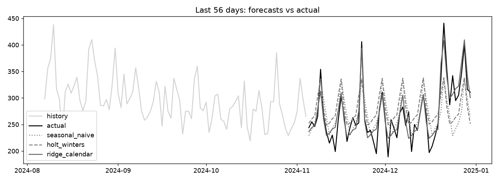

# retail-demand-forecast

Daily demand forecasting with rolling-origin backtesting: seasonal naive, Holt-Winters and a calendar regression.

## Task

Forecast four weeks of store demand and measure honestly whether a model beats the obvious baseline.

## Approach

- Daily units have trend, weekly and yearly seasonality, promotions and a year-end holiday effect.
- Three forecasters: repeat the last week, multiplicative Holt-Winters, and a ridge regression on log units with Fourier terms for the year, day-of-week dummies, promo and holiday flags.
- `backtest` uses rolling-origin splits (28-day horizon), and a test checks that no training index is later than a test index.

## Results



- 1,095 days, 10 backtest folds.
- MAE: ridge_calendar 19.04, holt_winters 28.29, seasonal_naive 34.6.
- sMAPE: ridge_calendar 6.7%, holt_winters 9.8%, seasonal_naive 12.1%.
- `ridge_calendar` cuts MAE by 45% against the seasonal naive baseline. It also knows promo and holiday flags in advance, which the other two do not use.

## Run

```bash
pip install -r requirements.txt
python run.py      # generates data, runs the analysis, writes reports/
pytest             # unit tests
```

## Layout

```
src/data.py     data generation (fixed seed, no downloads)
src/core.py     analysis / model code
run.py          end-to-end script
tests/          unit tests
reports/        figures and summary.json produced by run.py
```

## Notes

The data is generated by `src/data.py` with a fixed random seed, so the numbers above are reproducible. It is synthetic: it is meant to show the method, and results on real data will differ.

Stack: pandas, statsmodels, scikit-learn, matplotlib.
